# Sistem Informasi Gudang Bantuan Bencana (SIGudang) — Laravel Edition

> **Tugas Pertemuan 5: Laravel Fundamental**  
> *Mengubah Inventory Management System P4 (PHP Native) Menjadi Aplikasi Laravel Berbasis Arsitektur MVC Lengkap*

---

## 📋 Daftar Isi
1. [Tentang Sistem & Tujuan Migrasi](#-tentang-sistem--tujuan-migrasi)
2. [Fitur & Dokumentasi Tangkapan Layar (Screenshots) Seluruh Halaman](#-fitur--dokumentasi-tangkapan-layar-screenshots-seluruh-halaman)
   - [Bagian A — Portal Publik (Tanpa Autentikasi)](#-bagian-a--portal-publik-tanpa-autentikasi)
   - [Bagian B — Modul Autentikasi Multi-Role](#-bagian-b--modul-autentikasi-multi-role)
   - [Bagian C — Administrasi & Master Data (Akses Khusus Administrator)](#-bagian-c--administrasi--master-data-akses-khusus-administrator)
   - [Bagian D — Transaksi Gudang Logistik (Admin & Staff)](#-bagian-d--transaksi-gudang-logistik-admin--staff)
   - [Bagian E — Modul Staff Operasional & Penanganan Error](#-bagian-e--modul-staff-operasional--penanganan-error)
3. [Arsitektur MVC & Alur Request–Response](#-arsitektur-mvc--alur-requestresponse)
4. [Teknologi & Stack yang Digunakan](#-teknologi--stack-yang-digunakan)
5. [Skema Database, Migrasi, & Relasi Eloquent](#-skema-database-migrasi--relasi-eloquent)
6. [Akun Pengguna Default](#-akun-pengguna-default)
7. [Panduan Instalasi & Menjalankan](#-panduan-instalasi--menjalankan)
8. [Daftar Rute (Routes List)](#-daftar-rute-routes-list)
9. [Demonstrasi Alur Lengkap (Form → Validasi → Simpan → Redirect → Tampil)](#-demonstrasi-alur-lengkap)
10. [Integritas Aturan Bisnis P4 yang Dipertahankan](#-integritas-aturan-bisnis-p4-yang-dipertahankan)
11. [Hasil Pengujian Otomatis (Feature Tests)](#-hasil-pengujian-otomatis-feature-tests)

---

## 📦 Tentang Sistem & Tujuan Migrasi

**SIGudang Bantuan Bencana** adalah sistem informasi manajemen inventaris dan rantai pasok logistik kemanusiaan darurat. Sistem ini dirancang untuk:
1. **Transparansi Publik**: Masyarakat, donatur, dan relawan dapat memantau posisi persediaan sembako, obat-obatan, tenda pengungsian, dan riwayat penyaluran secara langsung tanpa perlu autentikasi.
2. **Integritas Transaksi Atomik**: Pencatatan barang masuk (donasi) dan barang keluar (penyaluran ke posko pengungsian) dilakukan dalam transaksi database terisolasi dengan *Row-Level Locking*, menjamin stok fisik akurat dan tidak akan pernah bernilai negatif.
3. **Kontrol Akses Berbasis Peran (RBAC)**: Memisahkan hak wewenang antara **Administrator** (pengelola master data, pasokan, laporan analitis, dan manajemen pengguna) dengan **Staff Operasional** (pencatat arus mutasi barang posko).

### Perubahan Arsitektur dari P4 (PHP Native) ke P5 (Laravel MVC):
| Aspek | P4 PHP Native | P5 Laravel MVC |
|---|---|---|
| **Struktur Database** | `database/schema.sql` manual | `database/migrations` via Artisan |
| **Data Pengujian** | `database/seed.sql` manual | `database/seeders` & Eloquent Factories |
| **Kueri Data** | PDO Prepared Statements manual | Eloquent ORM & Query Builder |
| **Alur Controller** | File skrip procedural terpisah | Resource Controllers (`ProductController`, dll) |
| **Tampilan / View** | HTML + PHP include tags | Blade Template Engine (`@extends`, `@section`, components) |
| **Keamanan Form** | Token manual di session | Token `@csrf` otomatis & validasi Request |
| **Autentikasi & Otorisasi** | Variabel `$_SESSION` manual | Laravel Auth Guard + Role Middleware (`role:admin`, `role:staff`) |

---

## 🚀 Fitur & Dokumentasi Tangkapan Layar (Screenshots) Seluruh Halaman

Berikut adalah tangkapan layar asli (*live captured*) dan penjelasan fungsional serta teknis untuk seluruh halaman sistem SIGudang:

---

### 🌐 Bagian A — Portal Publik (Tanpa Autentikasi)

#### 1. Beranda Publik (`/`)

- **Tujuan**: Halaman muka penyambutan masyarakat dan donatur.
- **Fitur Utama**: Hero banner interaktif "Transparansi Bantuan, Tepat Sasaran", 4 kartu ringkasan logistik utama (total jenis logistik, total stok fisik, penerimaan bantuan, dan penyaluran bantuan), alert peringatan dini stok menipis, dan feed riwayat aktivitas publik terkini.
- **Teknis Backend**: Query agregat ringan untuk agregasi stok publik, sanitasi output HTML penuh melalui Blade escaping `{{ ... }}`, navigasi responsif Bootstrap 5.

#### 2. Dashboard Publik (`/publik/dashboard`)
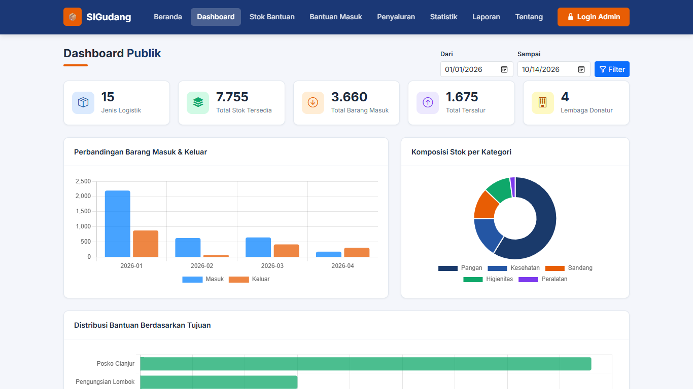
- **Tujuan**: Memberikan transparansi visual mengenai posisi logistik kemanusiaan secara komprehensif kepada publik.
- **Fitur Utama**: Grafik perbandingan bulanan barang masuk vs barang keluar berbasis Chart.js, diagram komposisi kategori bantuan, serta metrik ketersediaan barang siap salur.
- **Teknis Backend**: Query SQL `groupBy(DB::raw("DATE_FORMAT(date, '%Y-%m')"))` dengan fungsi agregat `SUM(CASE WHEN type='IN'...)` dan JSON serialization aman untuk data chart.

#### 3. Katalog Stok Bantuan Publik (`/publik/stok`)
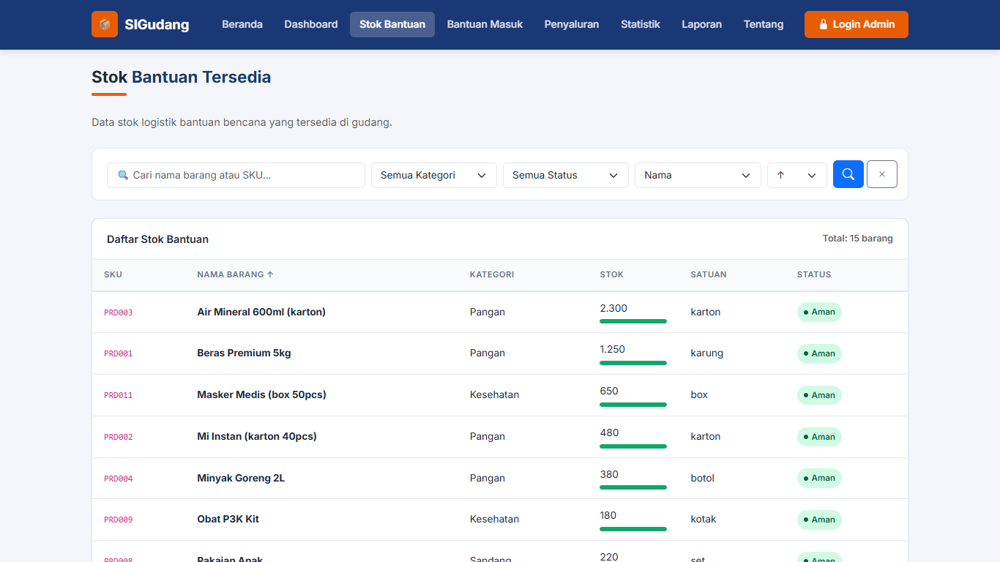
- **Tujuan**: Memungkinkan masyarakat dan relawan mengecek ketersediaan barang bantuan yang ada di gudang secara real-time.
- **Fitur Utama**: Pencarian instan (nama atau SKU), filter kategori donasi, filter status persediaan (Aman/Kritis), visualisasi progress bar ketersediaan barang terhadap batas minimum, dan paginasi halaman.
- **Teknis Backend**: Eloquent Query Builder dengan klausa `when()` bersyarat, relasi `with('category')`, dan sanitasi query string pencarian.

#### 4. Riwayat Bantuan Masuk Publik (`/publik/bantuan-masuk`)

- **Tujuan**: Mempublikasikan catatan donasi yang diterima secara akuntabel kepada masyarakat.
- **Fitur Utama**: Tabel riwayat bantuan masuk publik dengan filter rentang tanggal, pencarian donatur/lembaga, nomor referensi surat jalan, dan kuantitas barang.
- **Teknis Backend**: Eager loading Eloquent `StockMovement::with(['product', 'supplier'])` dengan filter keamanan `where('is_public', true)` dan `where('type', 'IN')`.

#### 5. Riwayat Penyaluran Bantuan Publik (`/publik/penyaluran`)

- **Tujuan**: Bukti pertanggungjawaban penyaluran logistik bencana ke posko-posko lapangan.
- **Fitur Utama**: Filter tanggal distribusi, filter lokasi posko penerima, pencarian jenis logistik yang disalurkan, dan nomor dokumen serah terima.
- **Teknis Backend**: Eager loading `StockMovement::with(['product', 'distributionTarget'])` dengan klausa `where('type', 'OUT')`.

#### 6. Statistik Distribusi Publik (`/publik/statistik`)
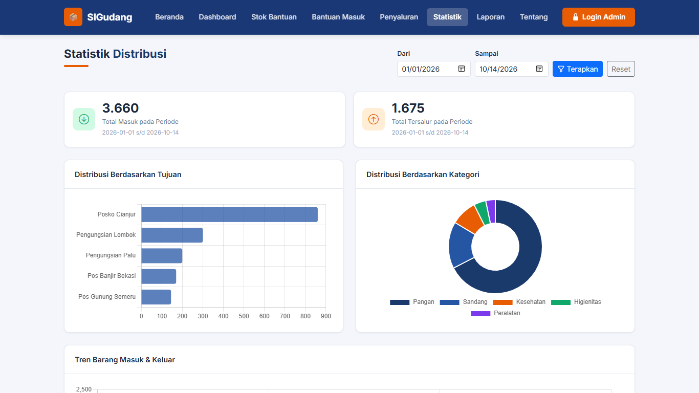
- **Tujuan**: Visualisasi analitik persebaran logistik bencana.
- **Fitur Utama**: Grafik distribusi bantuan per wilayah kabupaten/posko titik bencana, rasio barang tersalurkan per kategori, dan metrik persentase pemenuhan kebutuhan.
- **Teknis Backend**: Kueri agregat Eloquent `withCount()` dan `withSum()` dengan agregasi tujuan posko `distribution_targets`.

#### 7. Publikasi Laporan Terbuka (`/publik/laporan`)

- **Tujuan**: Ringkasan laporan berkala terbuka untuk transparansi audit publik.
- **Fitur Utama**: Rekapitulasi triwulanan/bulanan ketersediaan donasi, laporan arus barang masuk dan keluar, serta tombol cetak ramah printer (*print-friendly*).
- **Teknis Backend**: Rekapitulasi agregat berbasis tanggal pada `PublicController@laporanPublik`.

#### 8. Profil & Tata Kelola Sistem (`/publik/tentang`)

- **Tujuan**: Edukasi publik mengenai mekanisme tata kelola logistik bencana dan kontak darurat posko gudang.
- **Fitur Utama**: Diagram alur rantai pasok donasi (Penerimaan → Verifikasi Gudang → Alokasi Posko), komitmen integritas, dan kontak narahubung BPBD/posko.

---

### 🔐 Bagian B — Modul Autentikasi Multi-Role

#### 9. Halaman Login Sistem (`/login`)

- **Tujuan**: Gerbang masuk autentikasi pengguna dengan hak akses Administrator dan Staff Operasional.
- **Fitur Utama**: Formulir input username & password, show/hide password toggle, pesan kesalahan validasi, info kredensial demo cepat, dan proteksi token CSRF otomatis.
- **Teknis Backend**: Verifikasi otentikasi `Auth::attempt()`, regenerasi session `$request->session()->regenerate()` guna menolak serangan *Session Fixation*, dan pengalihan otomatis berdasarkan peran (`role`).

#### 10. Profil Pengguna & Ganti Password (`/profil`)
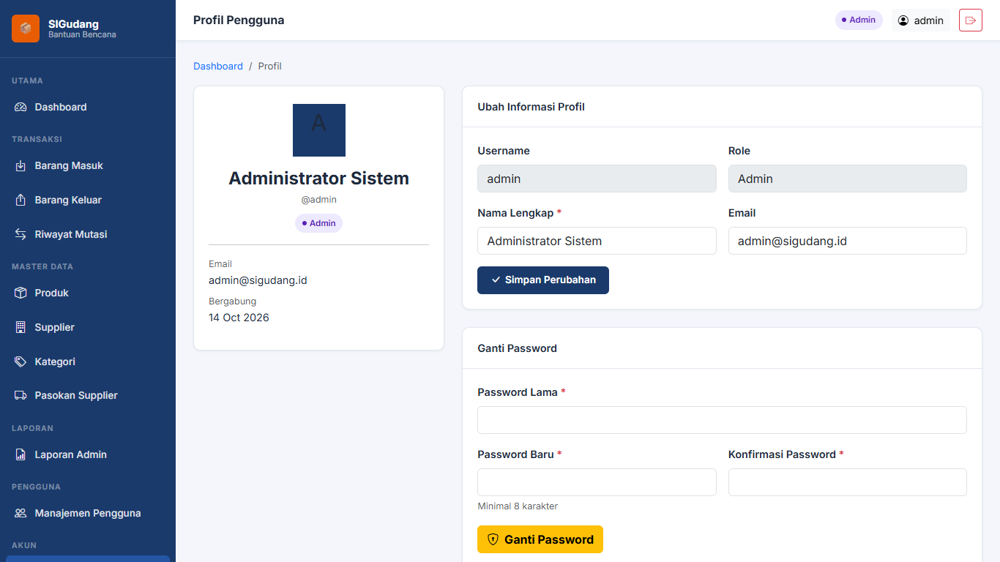
- **Tujuan**: Memungkinkan operator memperbarui identitas profil dan kata sandi akun masing-masing.
- **Fitur Utama**: Form update nama lengkap dan email, form ubah password dengan validasi password lama, indikator peran pengguna saat ini.
- **Teknis Backend**: Enkripsi password baru menggunakan `Hash::make()` dengan algoritma BCRYPT, sinkronisasi relasi 1:1 `user_profiles`.

#### 11. Konfirmasi Keluar Sistem
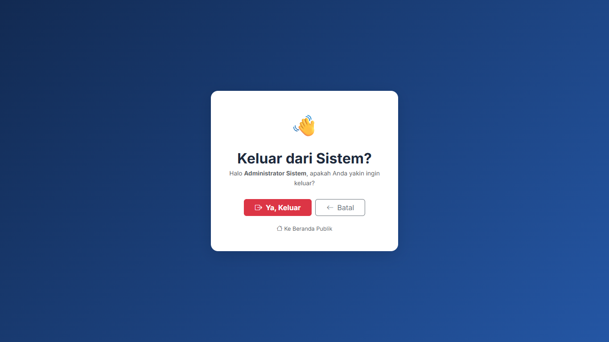
- **Tujuan**: Mencegah keluarnya pengguna secara tidak sengaja serta membersihkan sesi secara absolut.
- **Fitur Utama**: Dialog konfirmasi aman dengan token CSRF.
- **Teknis Backend**: `Auth::logout()`, pembersihan `$request->session()->invalidate()` dan `$request->session()->regenerateToken()`.

---

### 🛡️ Bagian C — Administrasi & Master Data (Akses Khusus Administrator)

#### 12. Dashboard Administrator (`/admin/dashboard`)
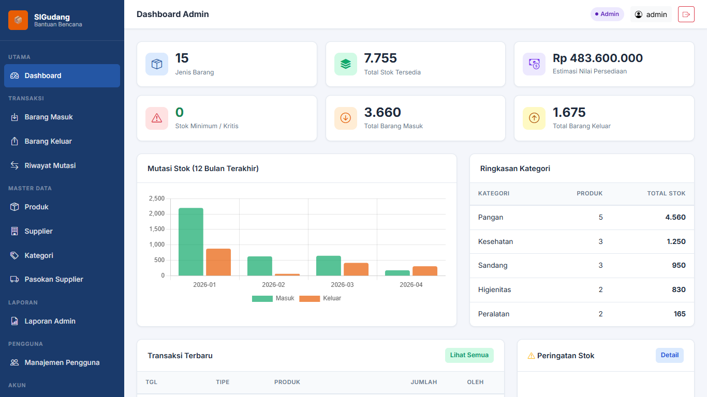
- **Tujuan**: Pusat monitoring menyeluruh inventaris gudang logistik bencana bagi pengambil keputusan.
- **Fitur Utama**: 6 kartu metrik agregat (Total Jenis Logistik, Total Fisik Stok, Estimasi Nilai Persediaan, Stok Kritis/Menipis, Total Penerimaan Masuk, Total Penyaluran Keluar), grafik mutasi bulanan (Chart.js), tabel stok kritis, dan feed transaksi terbaru.
- **Teknis Backend**: Subquery agregat Eloquent dioptimalkan dalam controller `DashboardController@adminDashboard`.

#### 13. Master Data Produk Logistik (`/products`)
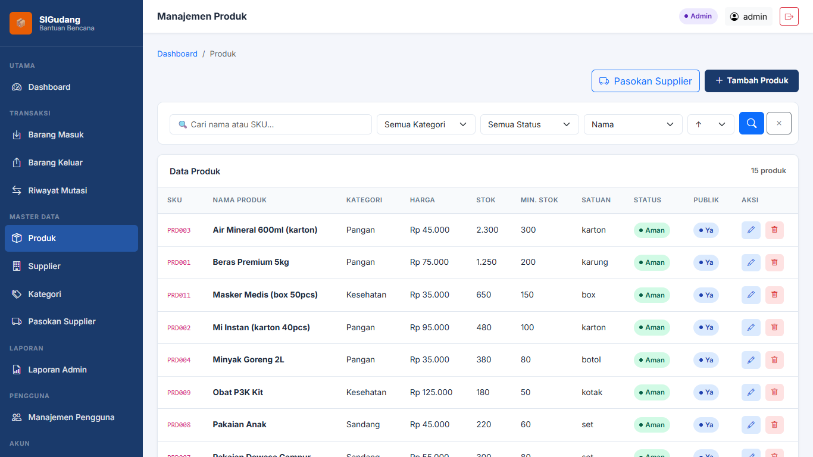
- **Tujuan**: Pengelolaan katalog barang logistik kemanusiaan (pangan, sandang, obat, tenda, higienitas).
- **Fitur Utama**: Form Tambah/Edit Produk lengkap dengan validasi, tombol akses cepat **Pasokan Supplier**, filter pencarian SKU & nama, filter kategori, badge status stok (Aman / Kritis), pengaturan stok minimum, serta proteksi integritas penghapusan.
- **Teknis Backend**: Resource Controller `ProductController`, aturan validasi `unique:products,sku`, dan pencegahan penghapusan jika produk memiliki mutasi stok (`$product->stockMovements()->exists()`).

#### 14. Master Data Supplier & Donatur (`/suppliers`)
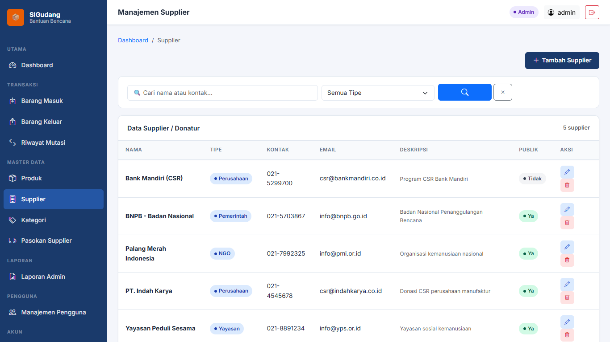
- **Tujuan**: Pengelolaan data lembaga donor, NGO (seperti PMI), instansi pemerintah (BNPB), dan donatur CSR swasta.
- **Fitur Utama**: CRUD data supplier, klasifikasi tipe lembaga, nomor kontak darurat, alamat, dan visibilitas publik.
- **Teknis Backend**: Validasi integritas relasi referensial sebelum aksi hapus supplier via `SupplierController`.

#### 15. Manajemen Pasokan & Donatur Produk — Relasi Many-to-Many (`/admin/product-suppliers`)
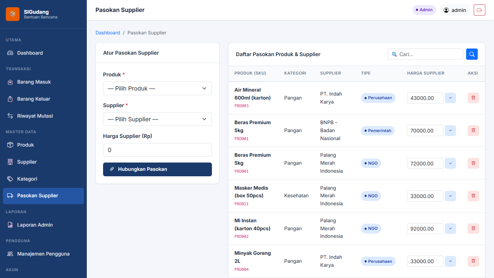
- **Tujuan**: Mengelola rantai pasokan dan donatur per item barang bantuan (diakses secara profesional dan terintegrasi melalui menu **Produk** > tombol **Pasokan Supplier**).
- **Fitur Utama**: Form pemetaan pasokan produk ke lembaga donor/supplier, penetapan harga referensi pasokan, pembaruan harga, dan filter pencarian real-time.
- **Teknis Backend**: Implementasi murni relasi **Many-to-Many (M : N)** menggunakan tabel perantara (*junction table*) `product_suppliers` dengan *Composite Primary Key* `(product_id, supplier_id)` dan metode `$product->suppliers()->syncWithoutDetaching(...)`.

#### 16. Manajemen Kategori Logistik (`/categories`)
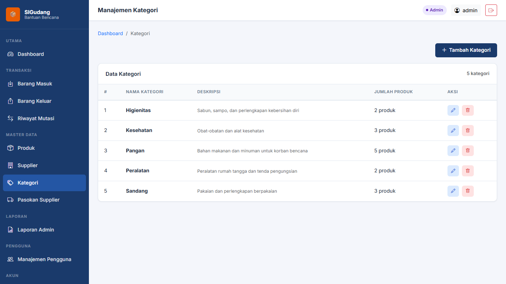
- **Tujuan**: Klasifikasi kelompok barang bantuan (Pangan, Sandang, Kesehatan, Peralatan, Higienitas).
- **Fitur Utama**: CRUD kategori, perhitungan jumlah item terdaftar dalam tiap kategori, dan proteksi integritas.
- **Teknis Backend**: Foreign key `ON DELETE RESTRICT` pada relasi `category_id` dan validasi controller sebelum delete.

#### 17. Laporan Agregat SQL & Cetak (`/admin/laporan`)
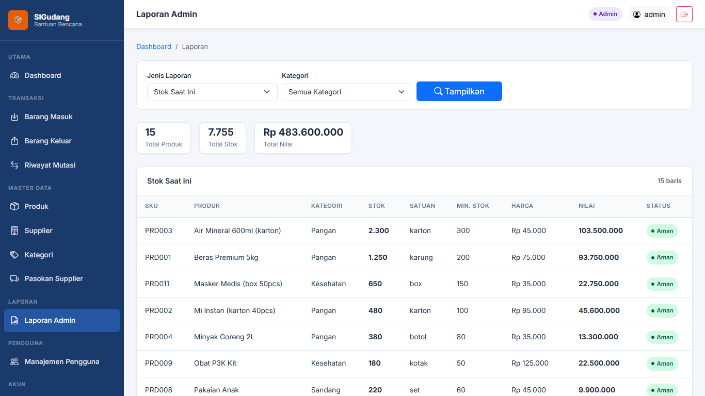
- **Tujuan**: Pembuatan laporan inventaris mendalam untuk pertanggungjawaban audit internal dan BNPB.
- **Fitur Utama**: 8 opsi tipe laporan (Stok Saat Ini, Stok per Kategori, Barang Masuk, Barang Keluar, Mutasi Stok, Distribusi per Tujuan, Nilai Persediaan, Aktivitas Pengguna), filter rentang tanggal, ringkasan kalkulasi otomatis, dan tombol Cetak (*Print*).
- **Teknis Backend**: Agregasi SQL query builder dengan `join()`, `groupBy()`, `sum()`, `count()`, dan `having()`.

#### 18. Manajemen Pengguna Sistem (`/users`)
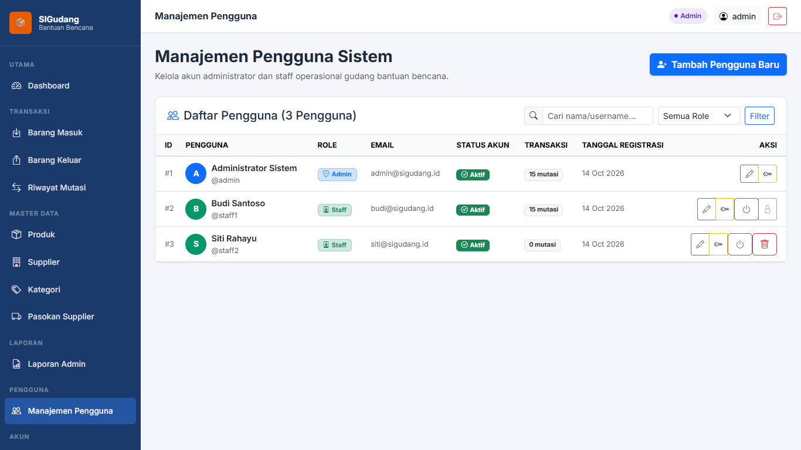
- **Tujuan**: Administrasi akun operator sistem dan kontrol hak akses berbasis peran (RBAC).
- **Fitur Utama**: Tambah user baru, pengubahan role (Admin / Staff), reset password operator, toggle status aktif/nonaktif akun, serta pencegahan penghapusan akun yang sedang aktif atau memiliki histori transaksi.
- **Teknis Backend**: Hashing otomatis via `Hash::make()`, proteksi server-side middleware `RoleMiddleware:admin`.

---

### 📦 Bagian D — Transaksi Gudang Logistik (Admin & Staff)

#### 19. Transaksi Barang Masuk / Donasi Diterima (`/transaksi/barang-masuk`)
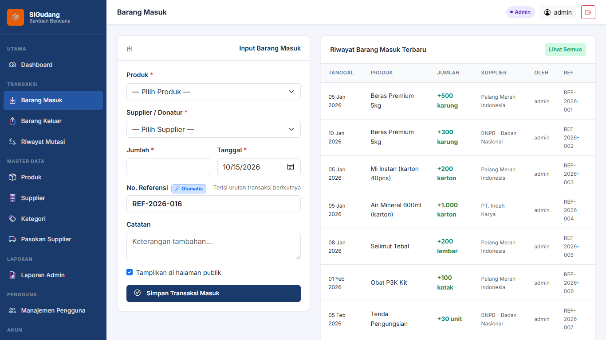
- **Tujuan**: Pencatatan resmi penerimaan logistik bantuan dari donatur ke dalam gudang.
- **Fitur Utama**: Form pemilihan produk, pemilihan supplier/donatur, input jumlah barang, nomor referensi otomatis (`REF-YYYY-XXX`), tanggal kedatangan, catatan surat jalan, serta tabel 10 transaksi penerimaan terkini.
- **Teknis Backend**: **Transaksi Database Atomik** (`DB::transaction(...)`). Secara simultan menambah stok fisik (`$product->increment('stock', $qty)`) dan menyimpan baris histori ke `stock_movements`.

#### 20. Transaksi Barang Keluar / Penyaluran Posko (`/transaksi/barang-keluar`)
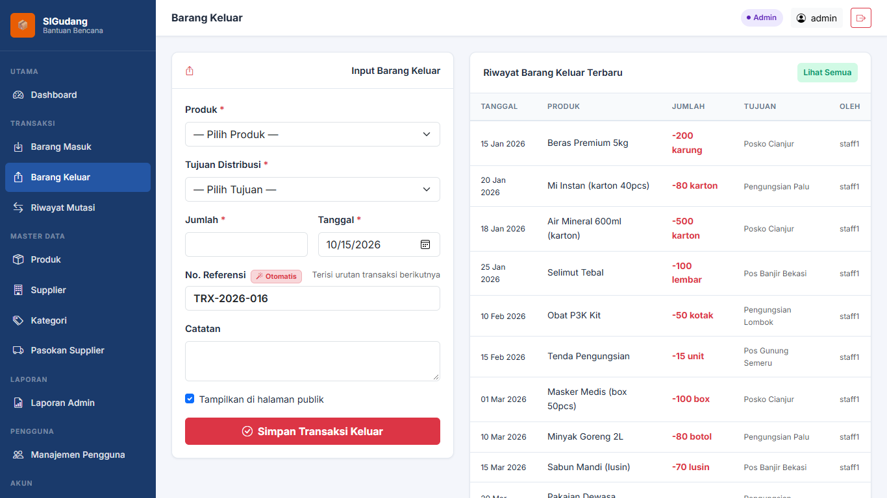
- **Tujuan**: Pencatatan pengeluaran bantuan logistik untuk didistribusikan ke posko pengungsian atau titik bencana.
- **Fitur Utama**: Form pemilihan produk dengan info sisa stok fisik, pemilihan titik posko tujuan distribusi, input kuantitas keluar, nomor referensi pengeluaran (`TRX-YYYY-XXX`), dan tabel riwayat penyaluran terbaru.
- **Teknis Backend**: Menerapkan **Row-Level Locking (`Product::lockForUpdate()->findOrFail($id)`)** dalam transaksi database guna mencegah *race condition*. Memvalidasi `stok >= kuantitas` secara ketat; jika stok kurang, transaksi dibatalkan sehingga stok dijamin **tidak akan pernah bernilai negatif**.

#### 21. Riwayat Mutasi Stok / Audit Trail (`/transaksi/mutasi-stok`)
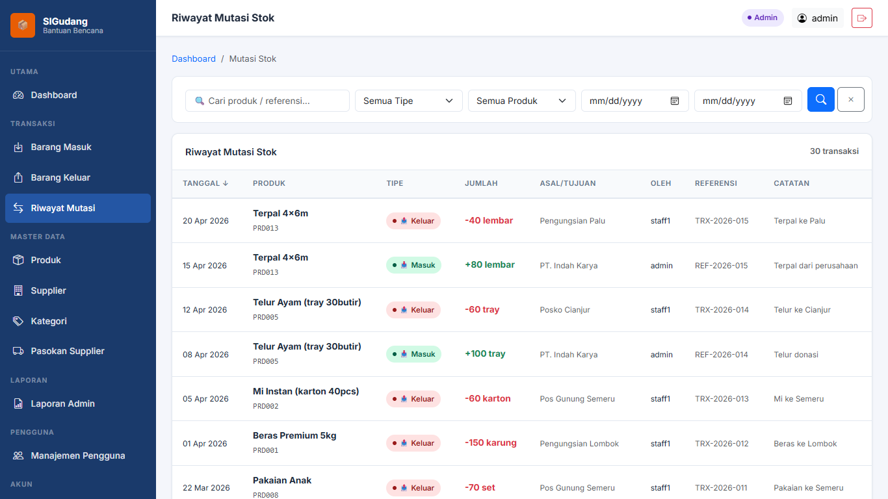
- **Tujuan**: Lembar audit lengkap seluruh mutasi barang masuk dan keluar tanpa ada rekaman yang terlewat.
- **Fitur Utama**: Filter tipe mutasi (IN / OUT), filter rentang tanggal, filter produk, pencarian nomor referensi, sorting dinamis, paginasi, dan badge warna pembeda arah arus logistik.
- **Teknis Backend**: Query multi-table dengan Eager Loading (`StockMovement::with(['product.category', 'supplier', 'distributionTarget', 'user'])`).

---

### 👷 Bagian E — Modul Staff Operasional & Penanganan Error

#### 22. Dashboard Staff Operasional (`/staff/dashboard`)

- **Tujuan**: Antarmuka kerja khusus staf logistik lapangan yang ringkas, cepat, dan fokus pada operasional fisik gudang.
- **Fitur Utama**: Akses tombol pintas langsung ke Catat Barang Masuk & Keluar, tabel pencarian cepat ketersediaan barang, metrik ringkas logistik, dan widget pemantau barang menipis. Menu konfigurasi master data dan manajemen user disembunyikan.
- **Teknis Backend**: Otorisasi level staf melalui middleware `RoleMiddleware:staff,admin`.

#### 23. Pengujian Akses Terlarang / HTTP 403 Forbidden
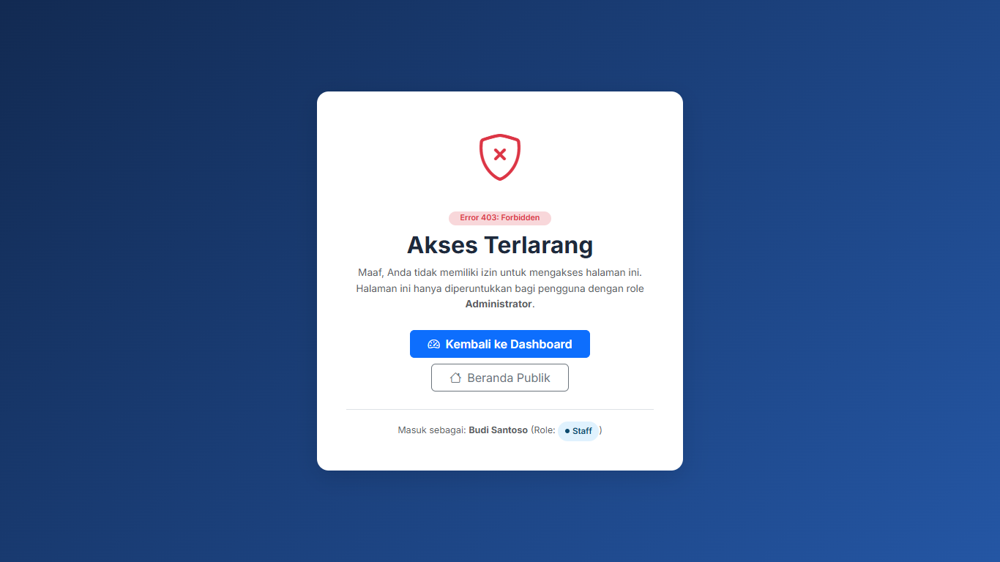
- **Tujuan**: Pembuktian proteksi keamanan server ketika staf mencoba membuka URL terlarang (misal: `/users` atau `/products`).
- **Fitur Utama**: Tampilan error profesional dengan status HTTP 403, identitas pengguna yang sedang login beserta rolenya, dan tombol kembali ke dashboard yang sesuai haknya.
- **Teknis Backend**: Dicegat langsung oleh `RoleMiddleware` di layer server dengan memanggil `abort(403)`.

#### 24. Penanganan Halaman Tidak Ditemukan / HTTP 404 Not Found

- **Tujuan**: Menangani URL salah atau rute yang tidak terdaftar pada sistem.
- **Fitur Utama**: Informasi ramah pengguna dengan panduan tautan kembali ke Beranda Publik atau Dashboard.
- **Teknis Backend**: View fallback kustom di `resources/views/errors/404.blade.php`.

---

## 🏛 Arsitektur MVC & Alur Request–Response

Aplikasi ini dibangun murni mengikuti pola desain **Model-View-Controller (MVC)** yang diinstruksikan pada Pertemuan 5:

```text
               HTTP Request (Browser / Client)
                             │
                             ▼
                    routes/web.php (Route)
                             │
                             ▼
              app/Http/Controllers/ (Controller)
              [Validasi Input $request->validate()]
                             │
            ┌────────────────┴────────────────┐
            ▼                                 ▼
   app/Models/ (Model)              resources/views/ (Blade)
   [Eloquent ORM & Relations]       [Layout, Komponen, Escaping]
            │                                 │
            ▼                                 │
     MySQL Database                           │
            │                                 │
            └────────────────┬────────────────┘
                             │
                             ▼
               HTTP Response (HTML / Redirect)
```

1. **Request**: Klien mengirim permintaan HTTP (misal: `POST /products` atau `GET /products`).
2. **Route**: Rute di `routes/web.php` meneruskan permintaan ke Controller yang sesuai (misal: `ProductController@store` atau `ProductController@index`).
3. **Controller**: Menerima request, menjalankan validasi `$request->validate()`, memanggil Model/Service untuk manipulasi data, dan memilih bentuk Response.
4. **Model**: Merepresentasikan entitas bisnis, relasi tabel database (1:1, 1:N, M:N), aturan *mass-assignment* (`$fillable`), dan casting tipe data.
5. **Database**: MySQL menyimpan data persediaan secara permanen dengan *Foreign Key Constraints* dan transaksi ACID.
6. **Response**: Controller mengembalikan tampilan view Blade atau pengalihan rute (`redirect()->route(...)`) dengan *Flash Message*.

---

## 🛠 Teknologi & Stack yang Digunakan

- **Framework**: Laravel 10.x
- **Bahasa Pemrograman**: PHP 8.1+
- **Database**: MySQL 8.x / MariaDB (Database: `inventory_db`)
- **Frontend / Styling**: Vanilla CSS Modern kustom (`assets/css/style.css`), Bootstrap 5.3, Bootstrap Icons, Google Fonts (Inter)
- **Visualisasi Data**: Chart.js 4.4 (Tren Arus Bantuan Bulanan, Komposisi Kategori, Volume per Posko)

---

## 🗄 Skema Database, Migrasi, & Relasi Eloquent

### Skema Relasional Tabel:
1. `users` (id, username, password, role ['admin', 'staff'], full_name, email, is_active, timestamps)
2. `user_profiles` (id, user_id [FK UNIQUE], full_name, phone, address, timestamps) — **Relasi 1 : 1** dengan `users`.
3. `categories` (id, name [UNIQUE], description, timestamps) — **Relasi 1 : N** dengan `products`.
4. `products` (id, category_id [FK], sku [UNIQUE], name, unit, price, stock, minimum_stock, description, is_public, timestamps).
5. `suppliers` (id, name, type, contact, email, address, description, is_public, timestamps).
6. `product_suppliers` (product_id [FK], supplier_id [FK], supplier_price, timestamps) — **Relasi Many-to-Many (M : N)** antara `products` dan `suppliers`.
7. `distribution_targets` (id, name, location, description, timestamps).
8. `stock_movements` (id, product_id [FK], user_id [FK], supplier_id [FK NULL], distribution_target_id [FK NULL], type ['IN', 'OUT'], quantity, date, reference, notes, is_public, timestamps).

### Implementasi Relasi Eloquent:
- `Product` $\leftrightarrow$ `Category`: `$product->category()` (`belongsTo`), `$category->products()` (`hasMany`).
- `Product` $\leftrightarrow$ `Supplier`: `$product->suppliers()` (`belongsToMany('product_suppliers')->withPivot('supplier_price')`).
- `Product` $\leftrightarrow$ `StockMovement`: `$product->stockMovements()` (`hasMany`).
- `User` $\leftrightarrow$ `UserProfile`: `$user->profile()` (`hasOne`), `$profile->user()` (`belongsTo`).
- `StockMovement` $\leftrightarrow$ `DistributionTarget`: `$movement->distributionTarget()` (`belongsTo`).

---

## 👤 Akun Pengguna Default

Database Seeder secara otomatis menginisialisasi 3 akun operator dengan hak akses RBAC:

| Peran (Role) | Username | Password | Deskripsi Wewenang |
|---|---|---|---|
| **Administrator** | `admin` | `admin123` | Akses penuh: Dashboard, Master Produk, Kategori, Supplier, Pasokan M:N, Transaksi Masuk/Keluar, Laporan, & Manajemen Pengguna. |
| **Staff Lapangan 1** | `staff1` | `staff123` | Akses operasional: Dashboard Staff, Catat Barang Masuk, Catat Penyaluran Posko, Riwayat Mutasi. |
| **Staff Lapangan 2** | `staff2` | `staff123` | Akses operasional posko lapangan 2. |

> *Catatan: Halaman login juga dilengkapi tombol klik-cepat untuk mengisi kredensial demo secara otomatis.*

---

## 🚀 Panduan Instalasi & Menjalankan

### 1. Prasyarat:
- PHP >= 8.1 dengan ekstensi `pdo_mysql`, `mbstring`, `openssl`.
- Composer terpasang di sistem.
- MySQL Server aktif pada port `3306`.

### 2. Konfigurasi Environment (`.env`):
Pastikan konfigurasi koneksi database di berkas `.env` sudah sesuai:
```env
APP_NAME="SIGudang Bencana"
APP_ENV=local
APP_DEBUG=true
APP_URL=http://localhost:8000

DB_CONNECTION=mysql
DB_HOST=127.0.0.1
DB_PORT=3306
DB_DATABASE=inventory_db
DB_USERNAME=root
DB_PASSWORD=
```

### 3. Migrasi & Seed Database Otomatis:
Jalankan perintah berikut pada terminal:
```bash
php artisan migrate:fresh --seed
```
*Perintah ini akan membuat 11 tabel migrasi dan mengisi data awal (users, profiles, categories, suppliers, products, product_suppliers, targets, & stock_movements).*

Atau Anda juga dapat mengimpor file dump SQL langsung melalui phpMyAdmin:
* File SQL: `database/inventory_db.sql`

### 4. Menjalankan Server Lokal:
```bash
php artisan serve
```
Aplikasi dapat dibuka melalui browser pada alamat: **`http://127.0.0.1:8000`** atau melalui Laragon pada **`http://localhost/SiGudang`**.

---

## 🛣 Daftar Rute (Routes List)

Semua rute diatur menggunakan rute bernama (*named routes*), pengelompokan (*grouping*), dan *resource controller*:

```bash
php artisan route:list
```

### Ringkasan Rute Utama:
- **Portal Publik**:
  - `GET /` $\rightarrow$ `home`
  - `GET /publik/dashboard` $\rightarrow$ `public.dashboard`
  - `GET /publik/stok` $\rightarrow$ `public.stok`
  - `GET /publik/bantuan-masuk` $\rightarrow$ `public.masuk`
  - `GET /publik/penyaluran` $\rightarrow$ `public.penyaluran`
  - `GET /publik/statistik` $\rightarrow$ `public.statistik`
  - `GET /publik/laporan` $\rightarrow$ `public.laporan`
  - `GET /publik/tentang` $\rightarrow$ `public.tentang`
- **Autentikasi & Akun**:
  - `GET /login`, `POST /login`, `POST /logout`
  - `GET /profil`, `PUT /profil`, `PUT /profil/password`
- **Operasional Bersama (Admin & Staff)**:
  - `GET /transaksi/barang-masuk`, `POST /transaksi/barang-masuk`
  - `GET /transaksi/barang-keluar`, `POST /transaksi/barang-keluar`
  - `GET /transaksi/mutasi-stok`
  - `GET /staff/dashboard`
- **Administrasi (Admin Only)**:
  - `GET /admin/dashboard`
  - `Route::resource('products', ProductController::class)` (CRUD 7 methods)
  - `Route::resource('categories', CategoryController::class)`
  - `Route::resource('suppliers', SupplierController::class)`
  - `GET|POST|DELETE /admin/product-suppliers`
  - `GET /admin/laporan`
  - `Route::resource('users', UserController::class)`

---

## 🔁 Demonstrasi Alur Lengkap

### Skenario: Form Tambah Produk → Validasi → Simpan → Redirect → Tampilkan Data

1. **Membuka Form**:
   - Operator membuka URL `http://127.0.0.1:8000/products/create` (melalui tombol *Tambah Produk Baru* di halaman produk).
   - `ProductController@create` memanggil view `resources/views/products/create.blade.php`.
2. **Validasi Request Server-Side**:
   - Pengguna mengirimkan form via metode `POST` ke `/products`.
   - `ProductController@store` mengeksekusi:
     ```php
     $validated = $request->validate([
         'sku' => ['required', 'string', 'max:50', 'unique:products,sku'],
         'category_id' => ['required', 'exists:categories,id'],
         'name' => ['required', 'string', 'max:200'],
         'unit' => ['required', 'string', 'max:30'],
         'price' => ['required', 'numeric', 'min:0'],
         'stock' => ['required', 'integer', 'min:0'],
         'minimum_stock' => ['required', 'integer', 'min:0'],
         'description' => ['nullable', 'string', 'max:1000'],
     ]);
     ```
   - Jika validasi gagal (misal SKU kosong atau duplikat), Laravel otomatis mengembalikan user kembali ke form dengan error message (`@error('sku')`) dan data input lama (`old('sku')`).
3. **Penyimpanan Data Eloquent**:
   - Jika valid, model `Product::create($validated)` mengeksekusi kueri `INSERT` ke tabel `products`.
4. **Redirect & Flash Message**:
   - Controller melakukan pengalihan:
     ```php
     return redirect()->route('products.index')
         ->with('success', 'Produk logistik baru berhasil ditambahkan.');
     ```
5. **Menampilkan Data**:
   - Browser menerima redirect dan memuat rute `products.index`.
   - Komponen alert `<x-alert type="success">` menampilkan pesan sukses berwarna hijau.
   - Produk baru langsung muncul pada tabel katalog persediaan dan dapat dicari/difilter.

---

## 🔒 Integritas Aturan Bisnis P4 yang Dipertahankan

1. **Transaksi Atomik Barang Masuk**:
   Setiap pencatatan donasi masuk dibungkus dalam blok `DB::transaction(...)`. Penambahan stok fisik (`$product->increment('stock', $qty)`) dan pencatatan riwayat audit `stock_movements` terjadi secara simultan tanpa risiko *partial insert*.
2. **Row-Level Locking Penyaluran (Barang Keluar)**:
   Pencatatan pengeluaran bantuan menggunakan `Product::lockForUpdate()->findOrFail($id)`. Sistem memvalidasi secara ketat apakah `$product->stock >= $quantity`. Jika kuantitas keluar melebihi stok fisik, sistem melempar `ValidationException` dan transaksi otomatis di-*rollback*, sehingga **stok fisik mustahil bernilai negatif**.
3. **Integritas Penghapusan (Foreign Key Safety)**:
   Produk yang sudah memiliki rekam jejak mutasi stok tidak dapat dihapus (`restrictOnDelete` dan validasi controller) guna melindungi integritas jejak audit (*audit trail*). Hal yang sama berlaku pada kategori dan akun pengguna yang memiliki histori transaksi.
4. **Proteksi Otorisasi 403 Forbidden**:
   Jika pengguna dengan peran `staff` mencoba mengakses modul master data pengguna di `/admin/users`, permintaan langsung dicegat oleh `RoleMiddleware` dan menghasilkan respons HTTP 403 (*Akses Terlarang*) yang ramah pengguna.

---

## ✅ Hasil Pengujian Otomatis (Feature Tests)

Unit & Feature Test telah disiapkan pada `tests/Feature/SigudangMigrationTest.php` untuk memvalidasi seluruh kriteria penerimaan (*Acceptance Criteria*):

```text
PASS  Tests\Feature\SigudangMigrationTest
✓ public pages are accessible
✓ login and redirection
✓ staff cannot access admin user management (HTTP 403)
✓ product crud and relationships
✓ product store validation
✓ stock movement in increases stock (Atomic Transaction)
✓ stock movement out prevents negative stock (Row-Level Locking)

PASS  Tests\Feature\ExampleTest
✓ the application returns a successful response

Tests:    9 passed (52 assertions)
Duration: 2.81s
```

Semua kriteria penerimaan Pertemuan 5 berhasil terpenuhi secara sempurna! 🚀
